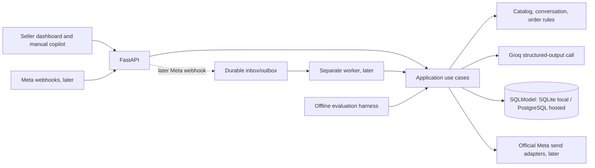

# Technical architecture

**Status:** Draft for review
**Product:** Tunisian shop assistant
**Stack requested:** Python, FastAPI, LangChain, LangGraph when justified
**Decision state:** Proposed architecture. Meta access, production model, hosting, and final persistence deployment remain unverified.

## Goal

Build a hosted multi-tenant application with strict shop-data isolation. Start with a manual reply copilot, then add official Meta messaging integrations without replacing the catalog, order rules, or evaluation harness.

## Decisions

| Concern | Decision | Why |
| --- | --- | --- |
| Application shape | Python modular monolith with FastAPI | Keeps domain rules local while giving us a deployable API; split services only after measured need. |
| Persistence | SQLModel; SQLite for local development, PostgreSQL for hosted shops | One model layer for a zero-setup local run and a transactional production database. Add Alembic migrations before a pilot that stores real shop data. |
| Reply generation | RAG: retrieve only relevant seller-approved records, augment one prompt, and generate every customer-facing draft with LangChain `ChatGroq` strict structured output | Grounded generation for product questions; greetings still go to the model with no product records. Avoid a tool loop because the application already owns and retrieves the catalog. |
| Workflow orchestration | No custom LangGraph graph in the first slice | This demo is one stateless draft request. Add explicit graph/checkpoint control when live conversations need pause/resume across seller handoffs and restarts. |
| Critical asynchronous work | Durable database-backed inbox/outbox plus a separate worker when Meta webhooks arrive | FastAPI in-process background tasks are not a durable job queue. Meta retries duplicate WhatsApp webhooks; persist and deduplicate before returning success. |
| Verification | Pytest for deterministic behavior; a small synthetic-data model eval harness | Separates business-rule regressions from model-quality and cost changes. |

This is the chosen architecture, not a menu. A local SQLite database is for learning and demo only; hosted multi-shop data uses PostgreSQL.

## Role of REA

REA is a developer research tool, not part of the product runtime. Its [README](https://github.com/morluto/rea) describes an MCP-connected reverse-engineering toolkit for inspecting applications, websites, and binaries and returning evidence-backed findings. We can use it during product discovery to inspect publicly accessible competitor flows or our own test application, subject to access rights and terms. Do not ship REA as a dependency, use it to access private customer accounts, or treat its findings as a substitute for official Meta API documentation.

Our product's customer-facing assistant remains a separate Python/FastAPI application using LangChain. The two tools solve different problems: REA helps us investigate software; LangChain helps our application interpret a shop conversation.

## Proposed system shape

Keep business rules in ordinary Python modules, expose them through FastAPI, and use SQLModel over SQLite locally and PostgreSQL for hosted shops. Do not split services before measured load requires it.



The model never sends messages, edits stock, or confirms orders directly. Application code validates the proposed answer and state transition before any side effect.

## Current modules and ownership

Keep the current local application as a small modular monolith. Each file owns one clear part of the RAG path:

```text
src/shop_assistant/
├── main.py                 # FastAPI routes, persistence access, request orchestration
├── catalog.py              # Product schema and approved catalog input
├── retrieval.py            # Retrieve relevant seller-approved catalog records
├── seller_instructions.py  # Seller notes and the separate instruction-model prompt
└── replies.py              # Reply prompt, model calls, structured output, evidence validation
```

The flow is `main.py → retrieval.py → replies.py → main.py response`. Keep retrieval and prompt construction separate so each can be tested and understood without making `main.py` an agent implementation. Add modules for policy knowledge, conversations, media, and channels when those domains are implemented—not as empty scaffolding.

Use seller-approved product and policy records as the RAG knowledge sources. Do not search the public web for shop-specific facts. A vector database is not justified for this small structured catalog; begin with bounded lexical/attribute retrieval, then add embeddings only if measured seller-reviewed cases show recall failures at larger catalog scale.

## Request flow

### Manual copilot demo

1. In the local demo, the seller creates an approved product card in SQLite through the API; hosted shops will use PostgreSQL.
2. The application loads the shop-scoped approved catalog and seller instructions, then retrieves only catalog records relevant to the buyer's product/category/attribute query. Greeting-only messages retrieve no product records.
3. A photo, voice message, video, or location does not reach a model. The API returns a seller handoff immediately.
4. Otherwise LangChain sends the buyer message, retrieved catalog records, seller instructions, and response rules in one augmented prompt. The model generates a structured reply or seller handoff.
5. Application code validates cited product and instruction IDs. An answer grounded in either source is kept. Greetings do not need either source. No message is sent.
6. Record provider, model, token usage, and latency for each model call. Durable per-shop billing records are added before commercial rollout.

### Seller instructions

The seller teaches the assistant with a free-text note, in the same spirit as Chatbase Build → Instructions. A separate structured model call, not the reply call, turns that note into rules, facts the assistant may answer itself, and cases that still need the seller. The shop stores the result. Reply generation includes those instructions as approved knowledge. If the model cites one of them, validation does not force `needs_seller`. Facts in neither the catalog nor the instructions still become a seller handoff. This is how ordinary conversation and taught shop facts stay with the assistant instead of escalating every time.

### Non-text buyer messages

A photo, voice message, video, or location is not interpreted and is not stored. The reply request can name that attachment kind, and the API returns a seller handoff with an empty customer draft. There is no vision or transcription model in this demo.

### Official channel flow, after Meta approval

1. Verify the webhook signature and parse the channel payload at the FastAPI boundary.
2. Insert the platform event under a unique channel event ID and return success promptly. Duplicate deliveries resolve to the existing event.
3. A worker claims the stored event. Non-text content becomes a seller handoff; the assistant does not interpret images, voice, video, or locations.
4. The application loads the shop's approved catalog, policies, conversation state, and any open order request.
5. The assistant may propose an answer or handoff. Deterministic application rules own order transitions, missing required fields, price/stock safety, opt-in, and channel messaging-window checks.
6. Validate the reply and its evidence. If validation fails or required facts are missing, hold and notify the owner. Otherwise send through the official channel adapter and record the delivery result.

## Model and workflow boundaries

The demo retrieves a small set of relevant records from the shop's approved catalog before building the model prompt. Greetings retrieve no catalog facts but still go to the model. A model tool loop would add an unnecessary round trip because the catalog is already loaded by the application; use tools only when the model must select among real external capabilities.

Keep these rules in deterministic Python code: evidence IDs must belong to the loaded catalog; required order fields, one-question-at-a-time progression, customer confirmation, seller accept/reject, availability freshness, duplicate prevention, and account/channel limits. A model suggests values; the domain validates and owns state changes. Groq does not support tool use and Structured Outputs in the same request, so keep those request modes separate.

## Data and reliability

- SQLModel owns the local demo's product records in SQLite. Hosted shops use PostgreSQL for shops, channel connections, products, variants, policies, conversations, order requests, handoffs, webhook events, usage, and audit records.
- Every hosted shop-owned query and write carries a shop identity. Enforce tenant isolation at the repository boundary and test cross-shop access before onboarding a second shop.
- This demo does not store buyer photos, voice, video, or locations. A non-text share is only a signal to hand the conversation to the seller.
- For official webhooks, persist events before acknowledging them, deduplicate by platform event ID, and preserve per-conversation ordering. Retries must converge without duplicate replies or orders.
- Save outbound intent and provider result so retries cannot send duplicate replies. Distinguish received, processing, held, sent, failed, and seller-reviewed states.
- Keep secrets in environment or a secret manager. Do not log message bodies, phone numbers, or addresses by default.
- Add per-shop usage and spend ceilings. If a ceiling is reached, hold automation and alert the owner; never silently switch to a lower-quality model.

## Model selection and cost control

Groq is the proposed free-demo provider for `openai/gpt-oss-20b`, using synthetic data only. Groq's rate-limit page lists 30 requests/minute, 1,000/day, 8,000 tokens/minute, and 200,000/day for this model, while describing its table as base Developer-plan limits. Verify the account's free-tier model access and live limits before the demo; the organization limits page is authoritative. The app requires a seller-supplied `GROQ_API_KEY`; it starts without one, but reply generation returns an explicit configuration error. Never send real customer data to a free-tier service.

For production, compare models on Tunisian Arabic, Arabizi, French, code-switching, grounded product accuracy, order extraction, handoff precision, p95 latency, token cost, availability, and data terms. Start with one model. Add cheaper routing or separate image/audio models only if measured savings preserve the quality bar.

Meter input and output tokens, image operations, audio duration/transcription, retries, and provider/model per shop. Keep Meta template charges and partner fees separate from model cost, especially when sellers pay Meta directly. Set allowance and overage from pilot workload and seller willingness to pay, with a gross-margin floor and a per-shop hard spend limit.

## Harness and evaluations

Create an offline runner that sends reviewed cases through the same reply and domain path used by the app, with no live channel sends. Use synthetic examples until sellers approve use of real examples.

Each case records the shop facts, buyer message or media reference, expected product/variant or handoff, required order fields, allowed claims, language style, and expected safety outcome. Score correctness and safety separately from fluency. Keep exact phrasing flexible. Track product-match accuracy, unsupported claims, missing-field handling, handoff decisions, latency, token/media usage, and cost.

Use deterministic tests for order state transitions, tenant isolation, duplicate webhooks, retry behavior, and platform-window checks. Use a small seller-reviewed model evaluation set for language quality and grounding. Human reviewers remain the source of truth for Tunisian dialect quality; a model judge can help triage cases but cannot replace them.

## Learning path while building

1. **FastAPI:** follow one request from route validation to a typed response. Learn how routers, dependencies, and lifespan resources fit together.
2. **Domain logic:** trace a confirmed buyer order through pure state transitions. Learn why the model does not own order state.
3. **LangChain:** inspect the `ChatGroq` structured-output schema, approved facts in the prompt, token usage, and one real synthetic evaluation request. Add `create_agent` and tools later when the workflow needs model-directed external actions.
4. **LangGraph:** add durable checkpointing only when the live workflow needs a real pause/resume after seller handoff. Compare a resumed thread with the durable domain record.
5. **Harness and evals:** run one reviewed Tunisian-language case, inspect the answer, evidence, latency, and cost, then add cases when a failure is discovered.

Code comments will explain non-obvious boundaries and safety invariants, not repeat what each line already says. Each implementation slice will include a short plain-language explanation alongside the code.

## First implementation slice

Build a FastAPI local app that lets a seller add an approved product card to SQLite and request one grounded draft reply or a seller handoff. Use LangChain strict JSON-schema output, deterministic evidence validation, per-call usage reporting, and two synthetic evaluation cases. No Meta integration, media ingestion, order persistence, production auth, or automatic message sending in this slice.

## Decisions to confirm before production integration

- Confirm PostgreSQL hosting, migration, backup, and retention requirements before a real-data pilot.
- Verify the Groq API key's organization limits and current data terms before using even synthetic demo traffic.
- Select the paid production model only after the seller-reviewed evaluation set exists.
- Validate whether sellers require WhatsApp Coexistence before finalizing channel onboarding.
- Before a pilot, add durable webhook inbox/outbox processing, idempotent channel adapters, and a persistent checkpoint strategy for live handoffs.

## References

- [FastAPI lifespan events](https://fastapi.tiangolo.com/advanced/events/)
- [Groq Structured Outputs and tool-use limitation](https://console.groq.com/docs/structured-outputs)
- [LangChain agents and `create_agent` for later tool-driven workflows](https://docs.langchain.com/oss/python/langchain/agents)
- [LangChain ChatGroq integration](https://docs.langchain.com/oss/python/integrations/chat/groq)
- [Groq rate limits](https://console.groq.com/docs/rate-limits)
- [FastAPI background tasks and limitations](https://fastapi.tiangolo.com/tutorial/background-tasks/)
- [Messenger App Review](https://developers.facebook.com/documentation/business-messaging/messenger-platform/app-review)
- [WhatsApp webhook overview](https://developers.facebook.com/documentation/business-messaging/whatsapp/webhooks/overview)
- [Product specification](product-spec.md)
- [Product delivery plan](product-plan.md)
